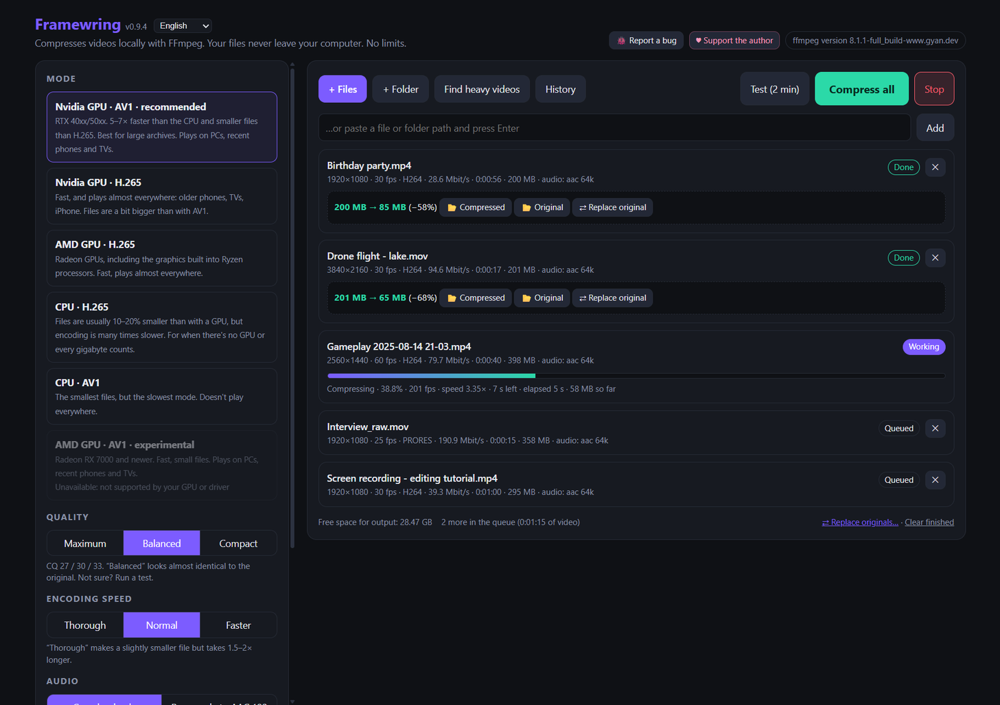
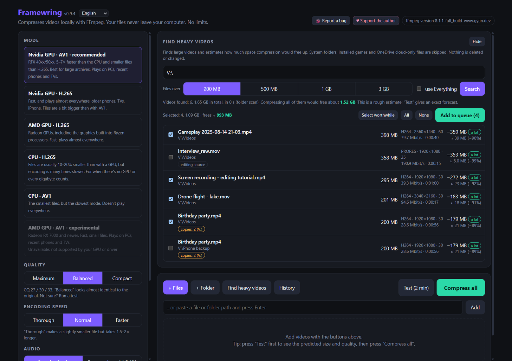
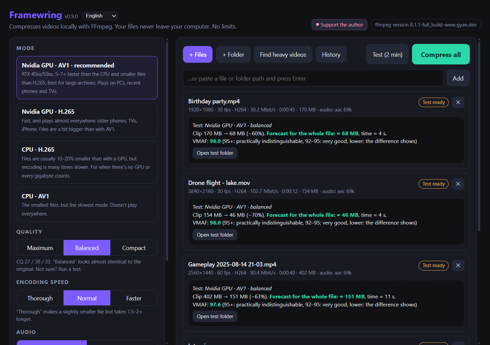
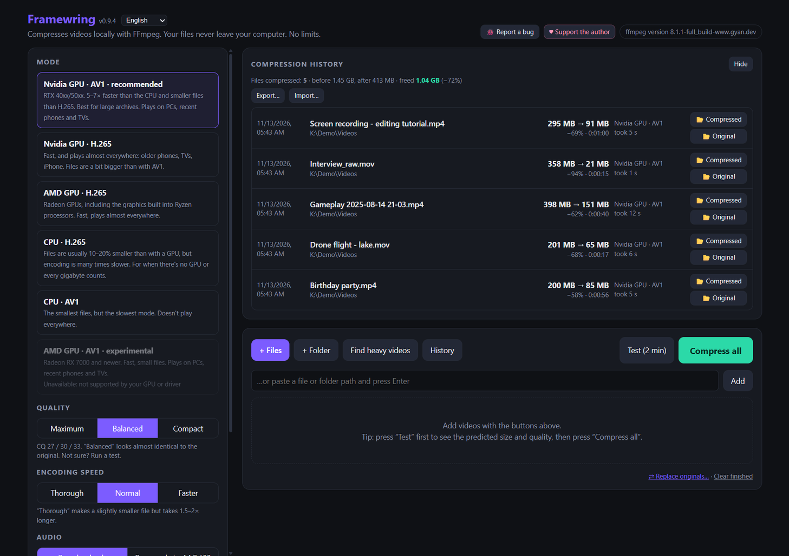
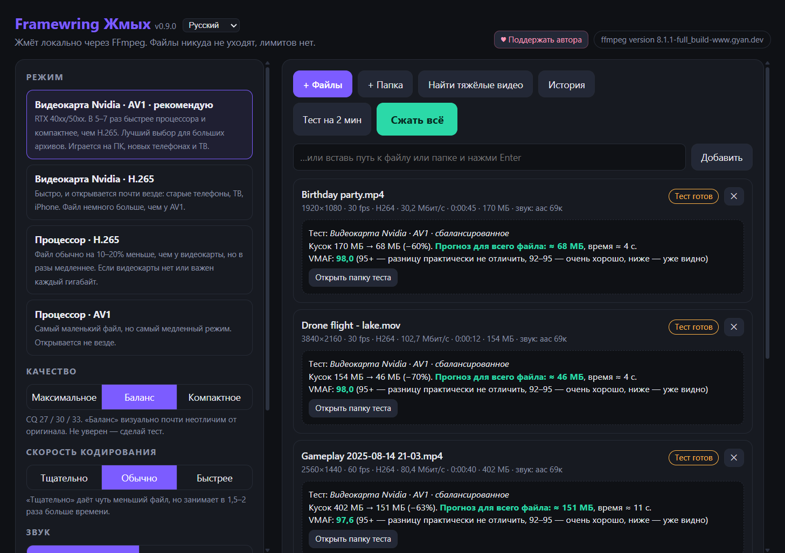
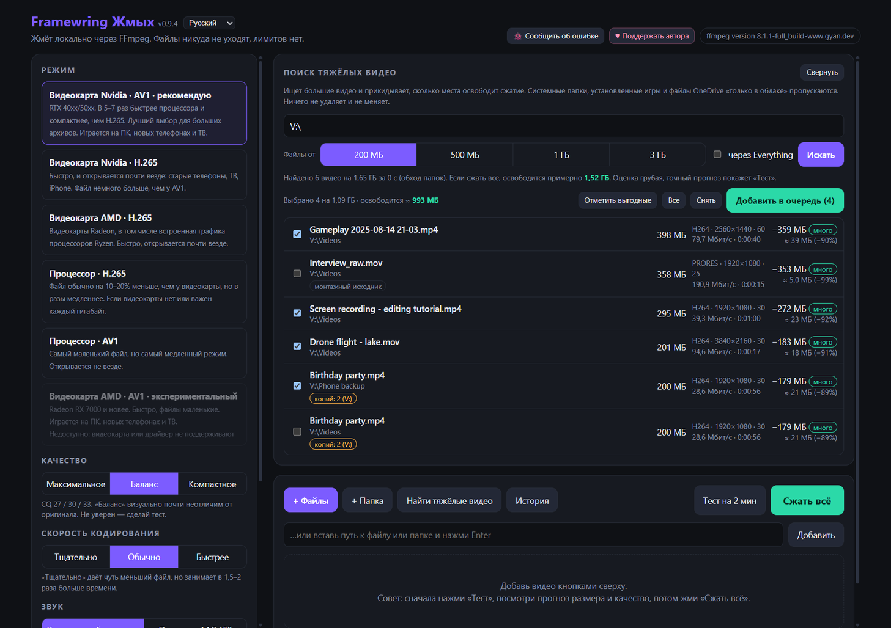
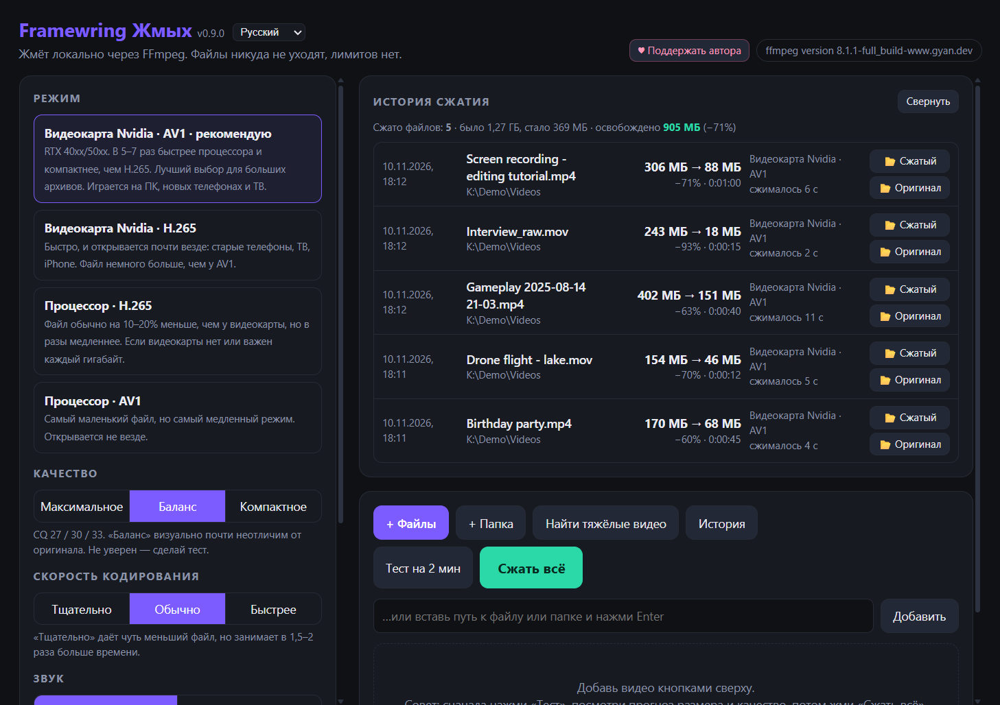

**English** · [Русский](#русский)

# Framewring — free local video compressor

**Your drive is full and you can't tell where the space went? Most of the time it's video.**
Screen and game recordings, phone clips, camera footage, old projects — gigabytes recorded at bitrates nobody needs,
scattered across folders, often in several copies.

**Framewring finds them, shows how much space each one wastes, and compresses them several times smaller with no
visible loss of quality.** You keep every video — it just takes a fraction of the space.
Real example: a 76.6 GB screen recording became 7.3 GB; more than 200 GB freed overall so far.

Free, local, no limits: your files never leave your computer.

**[⬇ Download for Windows 10/11 (64-bit)](https://github.com/remrem23/framewring/releases/latest)** · free · GPL v3

**How it works**

1. **Find heavy videos** — scans all your drives (in seconds with [Everything](https://www.voidtools.com/)) and lists
   every big video with the space compressing it would free. Duplicates and editing sources are marked.
2. **Test (2 min)** — compresses a short piece and shows the final size and quality (VMAF) before you commit.
3. **Compress all** — the compressed copies appear next to the originals in a `compressed` folder.
   Framewring never deletes anything: when you're happy with the result, delete the originals yourself.

Under the hood it's FFmpeg on an
Nvidia, AMD or Intel GPU (NVENC / AMF / Quick Sync, AV1 or H.265) or on the CPU (x265, SVT-AV1). The interface is in English, Russian, German, French, Spanish, Portuguese and Simplified Chinese
(language list in the header; the default follows your Windows language).

<table><tr>
<td width="33%"> <b>Find heavy videos</b>: savings estimate, duplicates, editing sources</td>
<td width="33%"> <b>Test (2 min)</b>: size forecast and VMAF quality before the full run</td>
<td width="33%"> <b>History</b>: everything compressed and the space freed</td>
</tr></table>

Screenshots use generated demo clips.

## Download

Get the latest version from [Releases](https://github.com/remrem23/framewring/releases/latest):

- **`Framewring-…-setup.exe`** — installer. Installs for the current user without admin rights
  (into `%LOCALAPPDATA%\Programs\Framewring`), uninstall via *Settings → Apps*.
- **`Framewring-…-portable.zip`** — portable version: unzip anywhere and run `Framewring.exe`.
  Settings and history are kept in the `data` folder next to it.

FFmpeg is included, nothing else to install.

> **"Windows protected your PC".** The app has no paid code-signing certificate yet, so SmartScreen warns on first launch.
> Click *More info* → *Run anyway*. To make sure the file was not tampered with, compare it with `SHA256SUMS.txt`
> from the release (in PowerShell: `Get-FileHash Framewring-…-setup.exe`).

**The only official page of the program is [github.com/remrem23/framewring](https://github.com/remrem23/framewring).**
Copies from other sites may be modified.

## Requirements

- **Windows 10 or 11, 64-bit.**
- **Microsoft Edge WebView2 Runtime** for the app window. Windows 11 already has it, Windows 10 usually does too.
  If it is missing, Framewring opens its interface in your default browser instead and tells you so.
- **GPU modes need a suitable card and an up-to-date driver from its vendor:**
  - **Nvidia** (NVENC): *Nvidia GPU · AV1* needs an RTX 40 or 50 series card, *Nvidia GPU · H.265* works on most
    GeForce GTX 10 series and newer.
  - **AMD** (AMF, AMD Software / Adrenalin driver): *AMD GPU · AV1* needs a Radeon RX 7000 series card or newer,
    or Ryzen 7040/8040-series graphics (Radeon 780M/880M); *AMD GPU · H.265* works on Radeon RX 400 series or newer,
    including Ryzen integrated graphics.
  - **Intel** (Quick Sync, Intel graphics driver): *Intel GPU · AV1* needs Intel Arc or Core Ultra graphics,
    *Intel GPU · H.265* works on most Intel graphics since about 2016.

  Framewring test-encodes every mode on startup and lets you pick only the ones that work. A GPU mode that fails is
  greyed out with the reason if that vendor's GPU is in your PC; modes for vendors you don't have are hidden.
  Without a suitable GPU the CPU modes (x265, SVT-AV1) are used — they work everywhere, just slower.
  The mode marked *recommended* is chosen in this order: Nvidia AV1 → Nvidia H.265 → AMD H.265 → Intel H.265 →
  AMD AV1 → Intel AV1 → CPU (AMD AV1 and Intel AV1 stay below H.265 until they are verified on real hardware).
  *AMD GPU · H.265* has been checked on real hardware (graphics built into a Ryzen 7 9700X); *AMD GPU · AV1* and
  the Intel modes have not been tested on real hardware yet — if you have such a card, please report how it went in
  [Issues](https://github.com/remrem23/framewring/issues).

## Features

- **Find heavy videos** on all drives: how much space compressing each file would free, duplicate detection,
  checkboxes to choose what to queue. With the free [Everything](https://www.voidtools.com/) installed the search takes seconds;
  without it a multi-threaded folder scan is used automatically.
- **GPU compression** (AV1 / H.265 on Nvidia, AMD or Intel; on Nvidia, 5–7× faster than the CPU) or **CPU compression** (x265, SVT-AV1) when every gigabyte counts.
- **Test on a piece of the video:** predicted final size, time and VMAF quality score before the full run.
- **A queue that survives restarts**, a *↻ Retry* button for failed files, **history** of everything compressed with the total space freed.
- **Drag & drop** files and folders onto the app window to add them.
- **Safe for your files:** originals are never modified or deleted, other files are never overwritten,
  the result is written to a temporary file and appears only when complete. Audio, text subtitles and the file date are kept;
  interlaced video is deinterlaced; variable-frame-rate recordings keep their timing.
- **Reliable:** free-space check, automatic retry on memory errors, works even if an antivirus or a player holds the file.
- **Updates in one click:** once per launch the app checks GitHub for a new version (can be turned off in settings).
  The installed version downloads the new installer, verifies its SHA-256 and updates itself, keeping settings,
  queue and history; the portable version opens the release page.
- **🐞 Report a bug** in the header opens the GitHub bug-report form with the program version, Windows version,
  graphics cards, FFmpeg version and mode already filled in (you see everything before sending), and can show the log file.

## How to use

1. **Find heavy videos** — or **+ Files** / **+ Folder**, or drag files onto the window.
2. **Test (2 min)** — see the predicted size and quality.
3. **Compress all.** Results go to a `compressed` subfolder next to each original (you can change the **Output folder**).

Full guide: [docs/USER-GUIDE.md](docs/USER-GUIDE.md) (also shipped with the app as `README.txt`).

## Where settings and logs are stored

| How you run it | Data folder |
|---|---|
| Installed (setup.exe) | `%APPDATA%\Framewring` |
| Portable (zip) | `data\` next to `Framewring.exe` |
| From source | next to `app.py` |

The folder holds `settings.json`, `queue.json`, `history.json`, `probe_cache.json` (the last three contain paths to your videos —
they never leave your computer) and, for the exe, `framewring.log`. Uninstalling keeps this folder so history is not lost;
delete it by hand if you want a clean slate.

## FAQ

**Windows says "Windows protected your PC".** See *Download* above: *More info* → *Run anyway*, and check the SHA-256 if in doubt.

**Compression fails with "access denied" / "permission denied" in Documents, Videos or Desktop.**
That is probably Windows *Controlled folder access* (ransomware protection). Open *Windows Security → Virus & threat protection →
Ransomware protection → Allow an app through Controlled folder access* and add `Framewring.exe` and `ffmpeg.exe` from the
program's `ffmpeg\bin` folder (installed: `%LOCALAPPDATA%\Programs\Framewring\ffmpeg\bin\ffmpeg.exe`).

**Do I need Everything?** No. It only makes the search faster (seconds instead of minutes). Without it Framewring scans folders itself.
If Everything is installed but not running, Framewring starts it in the tray for the search and closes it afterwards.

**Will it touch my original files?** No. Originals are only read, and a result can never replace an original.
If the output folder is the source folder, the result gets a `_compressed` suffix; in a common output folder you choose,
existing files from elsewhere are never overwritten (a number is added). Deleting originals is up to you, after you check the result.

**What about variable frame rate (phones, OBS, screen recorders)?** Frames are passed through with their original timestamps —
nothing is dropped or duplicated, and the test VMAF compares the right frames.

**Is anything sent to the internet?** Your files never leave your computer. The only network request is a check for a new version
on GitHub once per launch (can be turned off in settings); nothing about your files is sent. See *Privacy* below.

**Where do I report a bug?** Click **🐞 Report a bug** in the header: it opens the [Issues](https://github.com/remrem23/framewring/issues)
form with your system details filled in (a free GitHub account is needed). Please attach `framewring.log` — **📂 Show the log** opens its folder.

## Running from source

You need Python 3.8+ and FFmpeg with `libx265` / `libsvtav1` / `libvmaf`
(for example the [Gyan](https://www.gyan.dev/ffmpeg/builds/) build) in `PATH` or in an `ffmpeg/` folder next to `app.py`.
The app itself uses only the standard library; [pywebview](https://pywebview.flowrl.com/) is optional —
with it the app opens in its own window, without it in the browser.

- Windows: `START-Windows.bat` (installs Python and FFmpeg via `winget` if missing).
- Mac: `START-Mac.command`, Linux: `./start-linux.sh` — barely tested so far.

Building the exe, installer and portable zip: [packaging/](packaging/) (`build.py`, then `release.py`).

## Privacy

Everything runs on your computer: the interface is a local server on `127.0.0.1`, protected by a random token.
Your files never leave your computer. The only network request is a check for a new version on GitHub once per launch
(`api.github.com`, latest release of `remrem23/framewring`; can be turned off with *Check for updates on startup* in settings);
nothing about your files is sent. No analytics, no telemetry. When you click *Update*, the installer is downloaded from the
GitHub release. The app opens a web page only when you click a link or button (this repository, the bug-report form,
the release page, the support page, voidtools.com).

## Support the author

Framewring is free. If it saved you disk space and time — see the [support page](DONATE.md).

## Documentation

- [docs/USER-GUIDE.md](docs/USER-GUIDE.md) — user guide.
- [CHANGELOG.md](CHANGELOG.md) — what changed in each version.
- [DEVLOG.md](DEVLOG.md) — development history, measurements and decisions.
- [docs/ARCHITECTURE.md](docs/ARCHITECTURE.md) — how the program works, API, data files.
- [ROADMAP.md](ROADMAP.md) — plans and known limitations.
- [CONTRIBUTING.md](CONTRIBUTING.md), [SECURITY.md](SECURITY.md), [THIRD-PARTY-NOTICES.md](THIRD-PARTY-NOTICES.md).

## License

[GNU GPL v3](LICENSE). You may freely use, study and modify the program; modified versions may be distributed
only with source code, under the same license, and with authorship preserved.

The builds include [FFmpeg](https://ffmpeg.org) (Gyan build, GPL v3) and other components listed in
[THIRD-PARTY-NOTICES.md](THIRD-PARTY-NOTICES.md); their license texts are shipped in the program's `licenses` and `ffmpeg` folders.
[Everything](https://www.voidtools.com/) is a separate third-party program and is not included.

---

## Русский

**Framewring Жмых — локальный компрессор видео.**
**Диск забит, а куда делось место — непонятно? Чаще всего это видео.**
Записи экрана и игр, ролики с телефона, съёмка с камеры, старые проекты — гигабайты в никому не нужном битрейте,
разбросанные по папкам, часто ещё и в нескольких копиях.

**Framewring находит их, показывает, сколько места зря занимает каждое, и сжимает в разы без видимой потери
качества.** Все видео остаются с тобой — просто занимают в разы меньше места.
Реальный пример: запись экрана на 76,6 ГБ стала 7,3 ГБ; в общем освобождено более 200 ГБ.

Бесплатно, локально, без лимитов: файлы никуда не отправляются.

**[⬇ Скачать для Windows 10/11 (64 бит)](https://github.com/remrem23/framewring/releases/latest)** · бесплатно · GPL v3

**Как это работает**

1. **«Найти тяжёлые видео»** — обходит все диски (с [Everything](https://www.voidtools.com/) — за секунды) и показывает
   каждое большое видео и сколько места освободит его сжатие. Дубликаты и монтажные исходники помечены.
2. **«Тест на 2 мин»** — сжимает короткий кусок и показывает итоговый размер и качество (VMAF) до полного сжатия.
3. **«Сжать всё»** — сжатые копии появляются рядом с оригиналами, в папке `compressed`.
   Framewring ничего не удаляет: когда результат устроит, оригиналы удаляешь сам.

Framewring Жмых (английское название — *Framewring*) — программа для Windows на основе FFmpeg. Сжимает
на видеокарте Nvidia, AMD или Intel (NVENC / AMF / Quick Sync, AV1 или H.265) или на процессоре (x265, SVT-AV1). Интерфейс: русский, английский, немецкий, французский, испанский, португальский и китайский (упрощённый)
(выбор языка в шапке; по умолчанию — язык Windows).

<table><tr>
<td width="50%"> <b>Найти тяжёлые видео</b>: оценка экономии, дубликаты, монтажные исходники</td>
<td width="50%"> <b>История</b>: всё сжатое и сколько места освободилось</td>
</tr></table>

На скриншотах — сгенерированные демо-ролики.

### Скачать

Последняя версия — на странице [Releases](https://github.com/remrem23/framewring/releases/latest):

- **`Framewring-…-setup.exe`** — установщик. Ставится для текущего пользователя без прав администратора
  (в `%LOCALAPPDATA%\Programs\Framewring`), удаляется через «Параметры → Приложения».
- **`Framewring-…-portable.zip`** — портабл-версия: распакуй куда угодно и запусти `Framewring.exe`.
  Настройки и история хранятся в папке `data` рядом.

FFmpeg уже внутри, ничего доустанавливать не нужно.

> **«Windows защитила ваш компьютер».** У программы пока нет платной цифровой подписи, поэтому SmartScreen
> предупреждает при первом запуске. Нажми «Подробнее» → «Выполнить в любом случае».
> Проверить, что файл не подменён, можно по контрольным суммам из `SHA256SUMS.txt` в релизе
> (в PowerShell: `Get-FileHash Framewring-…-setup.exe`).

**Официальная страница программы — только [github.com/remrem23/framewring](https://github.com/remrem23/framewring).**
Копии с других сайтов могут быть изменены.

### Требования

- **Windows 10 или 11, 64 бит.**
- **Microsoft Edge WebView2 Runtime** — для окна программы. В Windows 11 он уже есть, в Windows 10 обычно тоже.
  Если его нет, Framewring откроет интерфейс в браузере по умолчанию и скажет об этом.
- **Для режимов на видеокарте нужна подходящая карта и свежий драйвер её производителя:**
  - **Nvidia** (NVENC): «Видеокарта Nvidia · AV1» — RTX 40xx/50xx, «Видеокарта Nvidia · H.265» — большинство карт
    начиная с GeForce GTX 10xx.
  - **AMD** (AMF, драйвер AMD Software / Adrenalin): «Видеокарта AMD · AV1» — Radeon RX 7000 и новее,
    а также графика Ryzen серий 7040/8040 (Radeon 780M/880M); «Видеокарта AMD · H.265» — Radeon RX 400 и новее,
    в том числе графика, встроенная в процессоры Ryzen.
  - **Intel** (Quick Sync, графический драйвер Intel): «Видеокарта Intel · AV1» — графика Intel Arc или Core Ultra,
    «Видеокарта Intel · H.265» — большинство графики Intel примерно с 2016 года.

  При запуске Framewring делает пробное кодирование в каждом режиме, выбрать можно только работающие. Режим видеокарты,
  который не прошёл проверку, показывается серым с причиной, если видеокарта этого производителя в компьютере есть;
  режимы производителей, которых в компьютере нет, скрыты. Без подходящей видеокарты работают режимы на процессоре
  (x265, SVT-AV1) — везде, просто медленнее. Режим с пометкой «рекомендую» выбирается в таком порядке: Nvidia AV1 →
  Nvidia H.265 → AMD H.265 → Intel H.265 → AMD AV1 → Intel AV1 → процессор (AMD AV1 и Intel AV1 стоят ниже H.265, пока
  не проверены на реальном железе). «Видеокарта AMD · H.265» проверена на реальном железе (графика, встроенная
  в Ryzen 7 9700X); «Видеокарта AMD · AV1» и режимы Intel на реальном железе ещё не проверялись — если у тебя такая карта,
  напиши, как прошло, в [Issues](https://github.com/remrem23/framewring/issues).

### Что умеет

- **Поиск тяжёлых видео** на всех дисках: сколько места освободит сжатие каждого файла, пометка дублей, выбор галочками.
  Если установлен бесплатный [Everything](https://www.voidtools.com/), поиск занимает секунды; без него автоматически работает многопоточный обход папок.
- **Сжатие на видеокарте** (AV1 / H.265 на Nvidia, AMD или Intel; на Nvidia — в 5–7 раз быстрее процессора) или **на процессоре** (x265, SVT-AV1), когда важен каждый гигабайт.
- **Тест на куске видео:** прогноз итогового размера, времени и оценка качества VMAF до полного сжатия.
- **Очередь, которая переживает перезапуск**, кнопка «↻ Повторить» у неудачных файлов, **история** всего сжатого с итогом освобождённого места.
- **Перетаскивание** файлов и папок прямо в окно программы.
- **Бережно к файлам:** оригиналы не изменяются и не удаляются, чужие файлы не перезаписываются,
  результат пишется во временный файл и появляется только целым. Сохраняются звук, текстовые субтитры и дата файла;
  черезстрочное видео деинтерлейсится; у видео с переменной частотой кадров сохраняется исходный тайминг.
- **Надёжность:** проверка свободного места, повтор при сбоях памяти, корректная работа, если файл держит антивирус или плеер.
- **Обновление в один клик:** при запуске программа один раз проверяет на GitHub, нет ли новой версии (можно отключить
  в настройках). Установленная версия сама скачивает новый установщик, сверяет его SHA-256 и обновляется, сохраняя настройки,
  очередь и историю; портабл-версия открывает страницу релиза.
- **«🐞 Сообщить об ошибке»** в шапке открывает форму на GitHub, где уже заполнены версия программы, Windows, видеокарты,
  версия FFmpeg и режим (всё видно до отправки), и умеет показать файл журнала.

### Как пользоваться

1. «Найти тяжёлые видео» — или «+ Файлы» / «+ Папка», или перетащи файлы в окно.
2. «Тест на 2 мин» — посмотреть прогноз размера и качество.
3. «Сжать всё». Результат — в подпапке `compressed` рядом с оригиналом (папку можно поменять в «Куда сохранять»).

Подробная инструкция — [docs/USER-GUIDE.md](docs/USER-GUIDE.md#русский) (в программе — файл `README.txt`).

### Где хранятся настройки и журнал

| Как запущено | Папка данных |
|---|---|
| Установлено (setup.exe) | `%APPDATA%\Framewring` |
| Портабл (zip) | `data\` рядом с `Framewring.exe` |
| Из исходников | рядом с `app.py` |

В папке лежат `settings.json`, `queue.json`, `history.json`, `probe_cache.json` (в трёх последних — пути к твоим видео,
они никуда не отправляются) и у exe-версии — журнал `framewring.log`. При удалении программы папка сохраняется, чтобы
не потерять историю; удали её вручную, если нужно начать с чистого листа.

### Частые вопросы

**«Windows защитила ваш компьютер».** См. «Скачать» выше: «Подробнее» → «Выполнить в любом случае»; при сомнениях сверь SHA-256.

**Сжатие падает с «отказано в доступе» в «Документах», «Видео» или на рабочем столе.**
Скорее всего, это «Контролируемый доступ к папкам» (защита от программ-вымогателей). Открой «Безопасность Windows →
Защита от вирусов и угроз → Защита от программ-шантажистов → Разрешить работу приложения через контролируемый доступ к папкам»
и добавь `Framewring.exe` и `ffmpeg.exe` из папки `ffmpeg\bin` программы
(у установленной: `%LOCALAPPDATA%\Programs\Framewring\ffmpeg\bin\ffmpeg.exe`).

**Обязателен ли Everything?** Нет, он только ускоряет поиск (секунды вместо минут). Без него Framewring обходит папки сам.
Если Everything установлен, но закрыт, Framewring запустит его в трей на время поиска и потом закроет.

**Тронет ли программа оригиналы?** Нет, оригиналы только читаются, и результат никогда не может заменить оригинал.
Если папка вывода совпадает с папкой оригинала, к имени добавляется `_compressed`; в общей папке вывода, которую ты указал,
чужие файлы не перезаписываются (к имени добавляется номер). Удалять оригиналы — тебе, после проверки результата.

**Видео с переменной частотой кадров (телефоны, OBS, запись экрана)?** Кадры передаются с исходными метками времени —
ничего не выбрасывается и не дублируется, а VMAF в тесте сравнивает правильные кадры.

**Отправляется ли что-то в интернет?** Твои файлы никуда не уходят с компьютера. Единственный запрос в сеть — проверка новой версии
на GitHub один раз при запуске (можно отключить в настройках); ничего о твоих файлах не передаётся. См. «Приватность».

**Куда писать об ошибке?** Нажми «🐞 Сообщить об ошибке» в шапке: откроется форма в [Issues](https://github.com/remrem23/framewring/issues)
с уже заполненными данными о системе (нужен бесплатный аккаунт GitHub). Приложи `framewring.log` — «📂 Показать журнал» откроет его папку.

### Запуск из исходников

Нужны Python 3.8+ и FFmpeg с `libx265` / `libsvtav1` / `libvmaf`
(например, сборка [Gyan](https://www.gyan.dev/ffmpeg/builds/)) в `PATH` или в папке `ffmpeg/` рядом с `app.py`.
Сама программа использует только стандартную библиотеку; [pywebview](https://pywebview.flowrl.com/) — по желанию:
с ним открывается своё окно, без него — браузер.

- Windows: `START-Windows.bat` (поставит Python и FFmpeg через `winget`, если их нет).
- Mac: `START-Mac.command`, Linux: `./start-linux.sh` — пока почти не тестировалось.

Сборка exe, установщика и портабл-архива — в [packaging/](packaging/) (`build.py`, затем `release.py`).

### Приватность

Программа работает только на твоём компьютере: интерфейс — локальный сервер на `127.0.0.1`, защищённый случайным токеном.
Твои файлы никуда не уходят с компьютера. Единственный запрос в сеть — проверка новой версии на GitHub один раз при запуске
(`api.github.com`, последний релиз `remrem23/framewring`; отключается настройкой «Проверять обновления при запуске»);
ничего о твоих файлах не передаётся. Аналитики и телеметрии нет. Когда ты нажимаешь «Обновить», установщик скачивается
из релиза на GitHub. Веб-страницу программа открывает, только когда ты нажимаешь ссылку или кнопку (этот репозиторий,
форма сообщения об ошибке, страница релиза, страница поддержки, voidtools.com).

### Поддержать автора

Framewring бесплатный. Если он сэкономил тебе место и время — [страница поддержки](DONATE.md#русский).

### Документация

- [docs/USER-GUIDE.md](docs/USER-GUIDE.md#русский) — инструкция.
- [CHANGELOG.md](CHANGELOG.md) — что изменилось в версиях.
- [DEVLOG.md](DEVLOG.md#русский) — история разработки, замеры и решения.
- [docs/ARCHITECTURE.md](docs/ARCHITECTURE.md#русский) — устройство программы, API, файлы данных.
- [ROADMAP.md](ROADMAP.md#русский) — планы и известные ограничения.
- [CONTRIBUTING.md](CONTRIBUTING.md#русский), [SECURITY.md](SECURITY.md#русский), [THIRD-PARTY-NOTICES.md](THIRD-PARTY-NOTICES.md#русский).

### Лицензия

[GNU GPL v3](LICENSE). Можно свободно пользоваться, изучать и изменять; распространять изменённые версии —
только с открытым исходным кодом, под той же лицензией и с сохранением указания авторства.

В сборки входят [FFmpeg](https://ffmpeg.org) (сборка Gyan, GPL v3) и другие компоненты из
[THIRD-PARTY-NOTICES.md](THIRD-PARTY-NOTICES.md#русский); тексты их лицензий лежат в папках `licenses` и `ffmpeg` программы.
[Everything](https://www.voidtools.com/) — сторонняя программа, в состав не входит.
